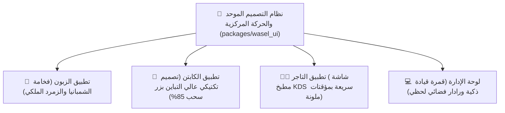

# Feature Specification: Unified Next-Gen App Redesign & Signature Motion System
# مواصفات الحلة الجديدة ونظام الحركة التكتيلي الموحد لمنظومة واصل نالوت

**Feature Identifier**: `specs/005-unified-app-redesign`  
**Created**: 2026-10-02 | **Last Updated**: 2026-10-22  
**Status**: Specifications Refined & Aligned (معتمدة ومطابقة للدستور وهندسة الحركة)  
**Target Ecosystem**: `flutter_mobile_app`, `flutter_driver_app`, `flutter_merchant_app`, `flutter_admin_app`, `packages/wasel_ui`

---

## 🎨 1. Executive Summary & Design Vision (الرؤية والهدف)

يهدف مشروع "الحلة الجديدة" لمنظومة **واصل نالوت** إلى ترقية التجربة البصرية والحسية لتطبيقات المنظومة الأربعة (تطبيق الزبون، تطبيق الكابتن، تطبيق التاجر، ولوحة الإدارة) من مجرد واجهات خدمية عادية إلى **نظام بصري استثنائي فائق الفخامة (Royal Berber & Mediterranean Luxury)** يعبر عن هوية جبل نفوسة العريقة وعراقة مدينة نالوت، مدعوماً بمحرك حركة وتفاعل تكتيلي ذكي (`WaselMotion`) يوفر تجربة سلسة وعالية الكفاءة تحترم شروط بيئة العمل الميدانية في نالوت.

---

## 🏛️ 2. الركائز البصرية والهندسية (Design & Motion Pillars)

### 💎 أ) لوحة الألوان السيادية (Color Palette Tokens):
1. **الزمرد الليلي العميق (`#041710` - Canvas)**:
   - خلفيات عميقة ومريحة للعين في الاستخدام الليلي والنهاري، تمنح شعوراً بالفخامة والاتساع.
2. **الذهب المعتق والراديانس (`#D4AF37` / `#F5D061` - Gold Accent)**:
   - أزرار الحجز والطلب، شارات العروض الساخنة، مؤشرات التقييم، وشارات التميز.
3. **عاج الشمبانيا (`#F8F5EE` - Primary Text)**:
   - نصوص ناصعة وقابلة للقراءة بوضوح تام دون توهج الأبيض الحاد المجهد للعين.
4. **أخضر الإنجاز المضيء (`#10B981` - Neon Emerald)**:
   - الحالات الحية، مؤشرات التوصيل المباشر، وتأكيدات التسليم الناجح.
5. **كهرمان نالوت (`#F59E0B` - Amber Glow)**:
   - طلبات قيد الطهي، تنبيهات الرادار، والمهمات المستعجلة.

---

### ✨ ب) هندسة الحركة ونظام التفاعل (Motion Design Architecture):
تلتزم جميع التطبيقات بمحرك الحركة المركزي [`WaselMotion`](file:///c:/Users/kalifa/Desktop/wasel-app/packages/wasel_ui/lib/src/motion/wasel_motion.dart) المعتمد في `packages/wasel_ui`:

1. **المنحنيات الفيزيائية المعتمدة (Signature Physics Curves)**:
   - **Wasel Signature Curve** للدخول الحاسم: `Cubic(0.05, 0.7, 0.1, 1.0)`.
   - **Wasel Joy Curve** للارتداد التكتيلي للنقر: `Cubic(0.175, 0.885, 0.32, 1.275)`.
   - **Wasel Pulse Curve** للنبضات والمؤشرات الدائرية: `Curves.easeInOutSine`.
2. **شخصية الحركة حسب طبيعة التطبيق (Motion Personality)**:
   - **تطبيق الزبون ولوحة الإدارة**: نمط الفخامة الملكية (**Premium Luxury**) بأزمنة انتقال تتراوح بين `300ms` و `450ms` وانسيابية ناعمة.
   - **تطبيق الكابتن وتطبيق التاجر**: نمط الاستجابة التكتيكية السريعة (**Tactical / Snappy**) بأزمنة رد فعل تتراوح بين `150ms` و `250ms` للتركيز الميداني ومنع التشتيت.
3. **طبقات الحركة الثلاث (Three Motion Layers)**:
   - **حركة أساسية (Primary)**: دخول البطاقات وانتقال المراحل.
   - **حركة ثانوية (Secondary)**: انكماش الظلال عند الضغط، إزاحة الأيقونات بمقدار 2px، وتأكيد كود OTP.
   - **حركة محيطية (Ambient)**: مسح الرادار الخفيف، وأمواج الشيمر (Shimmer)، ونبضات التنبيه (Pulse Glow).
4. **ميزانية التتابع الزمني (Stagger Budget)**:
   - في القوائم وشبكات المطاعم وتذاكر المطبخ، يتم تطبيق تتابع بمعدل تأخير `25-35ms` لكل عنصر، على ألا يتجاوز إجمالي زمن ظهور القائمة بالكامل **300ms** منعاً للبطء الإدراكي.
5. **معيار الوصول وتقليل الحركة (Mandatory Accessibility Bypass)**:
   - يلزم فحص `WaselMotion.isAnimationDisabled(context)` في جميع مكونات الحركة، وتخطي الرسوم المتحركة فوراً (`Duration.zero` و `Curves.linear`) عند تفعيل وضع إزالة الحركة في أجهزة أندرويد.

---

## 📱 3. هوية الشاشات والقيم الكمية المحددة لكل تطبيق

### 1. تطبيق الزبون (`Wasel Customer App`):
- **الهيدر التفاعلي الذكي**: ترحيب مخصص، محدد عنوان التوصيل الحي بنقرة واحدة، ومؤشر رصيد المحفظة ونقاط الولاء.
- **قصص وعروض المتاجر التفاعلية (Instagram-like Stories)**: شريط عروض مع عدادات تنازلية حية للخصومات المحدودة.
- **شبكة المطاعم والأصناف بتصميم المجلة المصورة**: بطاقات عريضة بصور عالية الجودة، شارات التقييم والوقت التقريبي وسعر التوصيل بالدينار الليبي (`د.ل`).
- **شريط التنقل السفلي العائم (Floating Dock Navigation)**: شريط زجاجي عائم يندمج مع تتبع الطلب النشط تلقائياً.

### 2. تطبيق الكابتن (`Wasel Captain App`):
- **الوضع التكتيكي الميداني (Tactical Field Mode)**: تباين عالي جداً لمقاومة انعكاس أشعة الشمس أثناء القيادة في جبال نالوت.
- **بطاقة الرادار والطلب الوارد**:
  - عداد دائري نبضي مشرق مدته **20 ثانية** مع تدرج لوني حركي (أخضر $\rightarrow$ كهرماني $\rightarrow$ أحمر).
  - زر السحب للتأكيد (**Swipe to Accept**): يشترط سحب **$\ge 85\%$** من عرض المسار للاعتماد، مع ارتداد نابض فوري (Snap-back) عند الإفلات دون اكتمال السحب.
- **مخطط سير الرحلة التفاعلي (4-Step Flow)**: إرشادات واضحة، وأزرار استلام كبرى، وتأكيد كود التسليم OTP بلمسة واحدة.

### 3. تطبيق التاجر والمطبخ (`Wasel Merchant KDS App`):
- **تذاكر الطهي الحية (High-Speed Kitchen Tickets)**: بطاقات طلب بألوان متدرجة تميز الوقت المنقضي:
  - أخضر: أقل من 5 دقائق (طلب جديد).
  - أزرق: بين 5 إلى 10 دقائق (قيد التجهيز الطبيعي).
  - كهرماني: بين 10 إلى 15 دقيقة (مستعجل).
  - أحمر نابض: أكثر من 15 دقيقة (متأخر).
- **إشعارات الوصول وطباعة الإيصالات**: دعم تنبيه وصول الكابتن، وتوفير معاينة سريعة للإيصال الحراري كملحق تشغيلي منظم.

### 4. تطبيق الإدارة والعمليات (`Wasel Admin App`):
- **قمرة القيادة الشاملة (Executive Cockpit)**: بطاقات إحصائية بالسيولة النقدية (COD) المحصلة، عدد الرحلات المنجزة، والطلبات النشطة.
- **خريطة الرادار الفضائية لكباتن نالوت**: تتبع حي للأيقونات مع حالة الكابتن (متاح / مشغول / أوفلاين) وزر تصفير إداري محمي برمز PIN `7788`.

---

## 👥 4. سيناريوهات المستخدمين وقصص العمليات

### قصة 1: تجربة الزبون الفاخرة والاستكشاف السلس (Priority: P1)
* **المستخدم**: زبون في نالوت يتصفح خيارات المطاعم.
* **السيناريو**: يفتح التطبيق فيرى شريط العروض بحلة ملكية أنيقة مع انتقال متتابع لطيف، يختار وجبته وتظهر الفاتورة بالدينار الليبي بوضوح تام، مع استجابة تكتيلية ناعمة عند النقر.

### قصة 2: الكفاءة الميدانية للكابتن تحت ضوء الشمس (Priority: P1)
* **المستخدم**: كابتن واصل يقود سيارته في ظهيرة مشمسة في نالوت.
* **السيناريو**: ورود طلب جديد ببطاقة رادار عالية التباين، وعداد 20 ثانية واضح، وزر سحب قوي يمنع اللمسات العرضية أثناء القيادة.

### قصة 3: وضوح المطبخ تحت الضغط التشغيلي (Priority: P1)
* **المستخدم**: طاهي في مطعم وقت الذروة في نالوت.
* **السيناريو**: شاشة KDS منظمة بنظام الكروت الكبيرة بألوان تعبر عن زمن الانتظار، مما يمنع نسيان أي وجبة ويبرز كود التسليم OTP بوضوح لا يقبل اللبس.

### قصة 4: قمرة القيادة والرقابة اللحظية للأدمن (Priority: P1)
* **المستخدم**: مدير العمليات في نالوت.
* **السيناريو**: متابعة حية لمؤشرات الأسطول والسيولة النقدية على رادار الخريطة والتحكم في دورة حياة الطلبات بدقة وتوازن محاسبي تام.

---

## 📋 5. خطة المواءمة التنفيذية (Architecture Roadmap)

1. **المرحلة 0**: توفير نماذج المعاينة التفاعلية HTML لجميع الشاشات وتوثيق الهوية البصرية.
2. **المرحلة 1**: مركزية التوكنز ومحرك الحركة داخل حزمة `packages/wasel_ui` وإتاحة طبقات التوافق العكسي في التطبيقات الأربعة.
3. **المرحلة 2**: ترقية واجهات التطبيقات الأربعة (الزبون، الكابتن، التاجر، الإدارة) بمكونات الحركة التكتيلية.
4. **المرحلة 3**: اختبارات إمكانية الوصول وتخطي الحركة (`disableAnimations`)، والفحص الساكن (`flutter analyze` = 0 issues)، والتجميع النهائي لحزم APK الإنتاجية.
